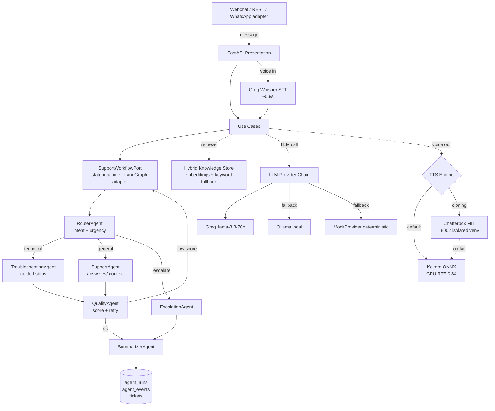

# CallForge

> **Multi-agent voice + LLM customer support platform.** Whisper STT (0.9s) → 6 specialized agents → Kokoro TTS (CPU, RTF 0.34). LLM provider fallback (Groq → Ollama → Mock) for zero-cost offline operation. Clean Architecture, multi-tenant, Windows-service deployable.

[](https://github.com/christianescamilla15-cell/callforge/actions/workflows/ci.yml)
[](https://github.com/christianescamilla15-cell/callforge/actions/workflows/seguridad.yml)
[](https://www.python.org/downloads/)
[](https://fastapi.tiangolo.com/)
[](LICENSE)

---

## What this proves

| Capability | Evidence |
|---|---|
| **Production-grade multi-agent orchestration** | 6 specialized agents (Router, Support, Troubleshooting, Escalation, Quality, Summarizer) coordinated via an explicit state machine, plus a **LangGraph adapter with measured parity** behind the same application port. The state machine is still the default engine and the production image ships without any framework ([ADR 0005](docs/adr/0005-adaptador-langgraph.md)) |
| **Evaluated RAG** | Versioned eval set (40-doc KB, 86 questions with expected source and reference answer), deterministic retrieval metrics (hit@k, MRR, citation coverage) over real `nomic-embed-text` vectors, citation-checked faithfulness and key-fact exactness, a CI gate with negative controls (shuffled embeddings, random retriever, altered numbers) and an optional local LLM judge: [docs/evaluacion_rag.md](docs/evaluacion_rag.md) |
| **Voice I/O at production latency** | Whisper STT 0.9s (Groq) + Kokoro ONNX TTS at RTF 0.34 on CPU only — GPU stays free for the LLM |
| **Cost-optimized resilience** | LLM provider chain (`Groq → Ollama → Mock`) keeps the system answering when any provider fails, with $0 floor (local + mock) |
| **Hybrid RAG with graceful degradation** | `nomic-embed-text` embeddings + keyword fallback when embedder is unavailable — lazy backfill for legacy docs. The support agent returns the fragments it cites (`citations`) |
| **Multi-tenant from day 1** | `tenant_id` scoping in every aggregate, per-tenant API keys, per-tenant metrics |
| **Clean Architecture** | Domain → Application → Infrastructure → Presentation. 100% of tests run offline (MockProvider + SQLite tmp, PostgreSQL 16 in CI) — no flaky CI |
| **Verifiable quality** | One test per business rule ([docs/reglas.md](docs/reglas.md), 93 rules), golden-file parity against an independent oracle with a negative control, E2E per role against the production image, versioned OpenAPI contract |
| **Operational maturity** | Deployable as Windows service via nssm. Alembic migrations auto-stamp pre-existing DBs at boot. Agent runs persist full trace (tokens, cost, latency, confidence, error) |
| **Cloning + voice synthesis** | Chatterbox MIT voice cloning in isolated micro-service (separate venv with torch cu124) avoids GPU contention — auto-fallback to Kokoro if down |
| **LLM specialization roadmap** | QLoRA fine-tune plan documented in [FINETUNE_RUNBOOK.md](FINETUNE_RUNBOOK.md): synthetic dataset → Unsloth/RunPod → GGUF export → Ollama. Specialization > scale for narrow tasks |

**By the numbers** (2026-11-25) — 6 pipeline agents · 2 interchangeable turn engines (state machine + LangGraph) · 8 use-cases · 18 API operations + webchat · 85 Python modules · ~7,900 LOC in `src/` · 327 tests in 24 suites (100% offline) · RAG eval set of 86 questions over 40 documents

---

## Architecture



Dependency rule: `presentation → application → domain`; `infrastructure` implements domain ports. Endpoints contain zero business logic.

The support turn sits behind one application port (`application/ports.py · SupportWorkflowPort`) with two engines: the explicit state machine (`WORKFLOW_ENGINE=state_machine`, the default, framework-free) and a LangGraph `StateGraph` adapter (`WORKFLOW_ENGINE=langgraph`, `pip install -r requirements-langgraph.txt`) that records a trace per node. Both share agents, policy and outcome builders; the parity suite proves they take the same path, make the same decisions and escalate the same way ([ADR 0005](docs/adr/0005-adaptador-langgraph.md)).

C4 model (context, containers, components), the support turn and the conversation lifecycle: [docs/arquitectura](docs/arquitectura/README.md). Design decisions: [docs/adr](docs/adr/). API contract: [docs/api/openapi.json](docs/api/openapi.json) (also live at `/docs`).

### Message flow (text)

1. **Router** classifies intent, category, urgency, frustration → picks next agent.
2. Knowledge retrieval: keyword + embeddings hybrid (`HybridKnowledgeStore`, similarity floor 0.55 calibrated empirically).
3. **Support** or **Troubleshooting** answers using ONLY that context (anti-hallucination).
4. **Quality** scores the answer. If low → 1 retry with feedback.
5. **Escalation policy** (testable dataclass, NOT inside the agent): quality_threshold, confidence_threshold, max_retries, customer-asked-for-human signal.
6. On escalate → **Escalation** generates handoff brief + **Summarizer** condenses history → creates `Ticket` + `Escalation` row.
7. Everything persists: messages, `agent_runs` (input/output/decision/confidence/latency/model/provider/tokens/cost/error), workflow events, LLM usage.

### LLM fallback chain

```
Groq (cloud, free tier) → Ollama (local) → MockProvider (deterministic)
```

If all fail, workflow returns a controlled message and logs a `fallback_used` event. System never crashes due to LLM unavailability. **Pattern transferable to any LLM-dependent system** ([infrastructure/llm/fallback.py](src/callforge/infrastructure/llm/fallback.py)).

---

## ADN (técnica reusada de proyectos previos)

| Patrón | Origen | Dónde vive aquí |
|---|---|---|
| Agentes + workflows + eventos + trazabilidad | NexusForge AI | `agents/`, `orchestration/`, tablas `agent_runs`/`agent_events` |
| LLM fallback chain con degradación limpia | yt-extract-service (`playbackFallback`) | `infrastructure/llm/fallback.py` |
| Degradación a humano sin romper UX | Verificarro (manual-first) | `EscalationAgent` + `EscalationPolicy` |
| Groq como LLM remoto barato/free | compras-cloud, yt-extract `/recommend` | `GroqProvider` |
| Verify-before-ship con tests por fase | Spacetime Lab | `tests/` (100% offline con MockProvider) |
| Despliegue local como Windows service | yt-extract-service | `scripts/install-windows-service.ps1` (nssm) |

---

## Quick start (zero cost default)

Requires Python 3.12 (the same version CI tests and the Docker image ships).

```powershell
python -m venv .venv
.\.venv\Scripts\Activate.ps1
pip install -e ".[dev]"
copy .env.example .env
python main.py        # http://localhost:8000/docs
```

Without configuring anything, responds with `MockProvider`. For real answers:
- Set `GROQ_API_KEY` in `.env` (free tier), or
- Run Ollama locally (`ollama run llama3.1`).

### Docker

```bash
docker compose up --build
docker compose --profile postgres up   # opt-in Postgres
```

### Voice

Whisper STT (Groq) + Kokoro TTS (CPU) work out of the box. For voice cloning with Chatterbox:

```powershell
python -m venv .venv-voice
.\.venv-voice\Scripts\python.exe -m pip install \
  torch==2.6.0+cu124 torchaudio==2.6.0+cu124 \
  --index-url https://download.pytorch.org/whl/cu124
.\.venv-voice\Scripts\python.exe -m pip install chatterbox-tts
.\.venv-voice\Scripts\python.exe -m uvicorn voice_server:app --port 8002
```

Endpoints:
- `POST /api/v1/voice/tts` — text → WAV
- `POST /api/v1/conversations/{id}/voice-message` — audio → STT → workflow → response + spoken reply
- WebChat UI at `/webchat` with 🎤/🔊 buttons

---

## Examples (curl)

```bash
# Health
curl http://localhost:8000/api/v1/health

# Ingest knowledge
curl -X POST http://localhost:8000/api/v1/knowledge/documents \
  -H "Content-Type: application/json" \
  -d '{"title":"Reiniciar el modem","content":"Desconecta el modem 60s y reconecta.","tags":["internet"]}'

# Start conversation
curl -X POST http://localhost:8000/api/v1/conversations/start \
  -H "Content-Type: application/json" \
  -d '{"customer_external_id":"cliente-42","customer_name":"Ana"}'

# Send message (use the returned conversation_id)
curl -X POST http://localhost:8000/api/v1/conversations/<ID>/message \
  -H "Content-Type: application/json" \
  -d '{"content":"Mi internet no funciona desde ayer"}'

# Read conversation / tickets / metrics
curl http://localhost:8000/api/v1/conversations/<ID>
curl http://localhost:8000/api/v1/tickets
curl http://localhost:8000/api/v1/metrics
```

If `API_TOKEN` is set in `.env`, add `-H "X-API-Token: <token>"` to each request (`/health` stays open for probes).

---

## Tests

```bash
pip install -r requirements-dev.txt
ruff check .
pytest                                   # 327 tests, offline (PostgreSQL ones skip without a database)
PYTHONPATH=src python -m callforge.evaluation.rag --compuerta   # RAG gate (deterministic, cached real embeddings)
```

- **One test per business rule**: [docs/reglas.md](docs/reglas.md) maps every rule (routing, quality retry, escalation, conversation lifecycle incl. invalid transitions, tenant isolation, LLM fallback order, RAG, migrations, voice) to the tests that cover it; `tests/test_reglas_doc.py` keeps the table honest.
- **Golden parity** (`tests/test_paridad_golden.py`): 7 conversations / 12 turns through the API vs. an independent oracle (`tests/golden/generar_golden.py`), multiset comparison, control figures (runs, events, tickets, tokens, cost in `Decimal`) and a negative control that must detect seeded differences.
- **Engine parity** (`tests/test_paridad_motores.py`): 28 scripted scenarios (every branch of the turn) run on the state machine and on the LangGraph adapter and must match field by field: agent sequence, each run's decision and confidence, the exact input each agent received, events, ticket/escalation and reply. The flow rules and the golden batch also run on both engines. Negative control: a mutated graph (no low-confidence escalation, no retry edge) differs in exactly the scenarios that exercise that edge.
- **RAG evaluation** (`tests/test_evaluacion_rag.py`, `python -m callforge.evaluation.rag --compuerta`): deterministic gate over the versioned eval set; it must fail with shuffled embeddings, a random retriever or altered numbers (also checked in CI). Numbers and findings: [docs/evaluacion_rag.md](docs/evaluacion_rag.md).
- **E2E per role** (`tests/e2e/`): admin, tenant operator, global token, anonymous and webchat customer; CI also runs it over real HTTP/WebSocket against the production image.
- **PostgreSQL 16**: `CALLFORGE_TEST_POSTGRES_URL=postgresql+psycopg2://... pytest tests/test_postgres.py`.
- Scripts that need a GPU, Ollama, RunPod or real API keys are manual and listed in [RUNBOOK.md](RUNBOOK.md).

## Deployment

Render Blueprint ([render.yaml](render.yaml)): Docker image from `main`, health check `/api/v1/health`. CI builds that same image, starts it with the Blueprint's variables and runs the smoke test and the E2E against it. Deploy, verification (`herramientas/humo.sh`), rollback and the Windows/nssm service: [RUNBOOK.md](RUNBOOK.md).

## Security

Every change runs CodeQL, Semgrep, Trivy (dependencies, Dockerfile and image), gitleaks over the whole history and an SBOM; how to report a vulnerability and how exceptions are handled: [SECURITY.md](SECURITY.md).

## Roadmap

- ✅ Alembic migrations embedded, auto-stamp at boot
- ✅ Hybrid retrieval (embeddings + keyword) with empirically-calibrated 0.55 floor
- ✅ Guided resolution: `ResolutionStep` persistent — Troubleshooting agent sees prior steps, never repeats
- ✅ Webchat (`/webchat`) + WebSocket (`/webchat/ws`) reusing same use cases
- ✅ Dashboard (`/dashboard`) over `/metrics` + tickets tray, auto-refresh
- ✅ Multi-tenant: `tenants` table + `tenant_id` scoping in repos, per-tenant API keys + metrics
- ✅ QLoRA fine-tune runbook ([FINETUNE_RUNBOOK.md](FINETUNE_RUNBOOK.md)) — Unsloth + RunPod + GGUF for Qwen3-4B specialization
- 🚧 WhatsApp / email channel adapters (Meta/SMTP creds required; pattern documented in `routes/webchat.py`)
- 🔮 Redis session/response cache (deferred until volume justifies)
- 🔮 Dedicated vector DB (ChromaDB/FAISS) when corpus exceeds ~thousands of docs

See [ROADMAP_VOZ.md](ROADMAP_VOZ.md) and [ROADMAP_FINETUNE.md](ROADMAP_FINETUNE.md) for phase-by-phase plans.

---

## License

[MIT](LICENSE) © 2026 Christian Hernández Escamilla.

## Author

**Christian Hernández Escamilla** — AI Engineer · Multi-Agent Orchestration · Voice + LLM systems
[GitHub](https://github.com/christianescamilla15-cell) · christianescamilla15@gmail.com
