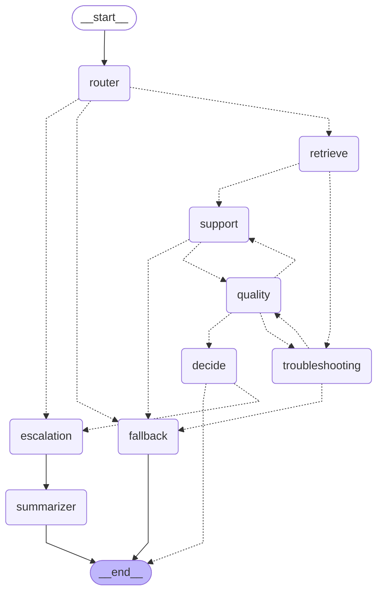

# ADR 0005 · LangGraph como ADAPTADOR del turno, no como reemplazo de la máquina de estados

- Estado: aceptada · Fecha: 2026-11-25 · Decide: el dueño del repositorio

## Contexto
El turno de soporte (Router → Support/Troubleshooting/Escalation → Quality → Summarizer, con reintento por
calidad y escalamiento por política) es una máquina de estados explícita en `orchestration/workflow.py`, sin
framework. Sus reglas tienen una prueba cada una (`docs/reglas.md`, secciones 1–3, 5 y 7) y el lote golden
la compara contra un oráculo independiente. LangGraph es el estándar de facto para expresar flujos de agentes
como grafo (visualizable, con estado tipado y puntos de extensión: memoria por hilo, interrupciones con humano
en el ciclo, ejecución en paralelo), y era razonable preguntarse si conviene adoptarlo.

## Decisión
LangGraph entra como un **adaptador** detrás del mismo puerto de aplicación, no como reemplazo:

- `application/ports.py` define `SupportWorkflowPort`; `SendMessage` y las rutas dependen del puerto.
- `SupportWorkflow` (máquina de estados) sigue siendo el motor por omisión y la imagen de producción **no
  instala LangGraph**: no hay dependencia de framework en el camino de producción.
- `orchestration/langgraph_workflow.py` implementa el puerto con un `StateGraph` compilado (abajo), activable
  con `WORKFLOW_ENGINE=langgraph` e instalable con `requirements-langgraph.txt` (versión exacta).
- Los dos motores comparten agentes, `EscalationPolicy` y los constructores de resultado
  (`orchestration/steps.py`: evento, ticket, escalamiento, respaldo controlado, paso de diagnóstico). Sólo
  difiere el **flujo de control**, que es justo lo que mide la paridad.
- Cada nodo del grafo deja una traza (`NodeTrace`: nodo, latencia, agentes que llamó, a dónde fue) en
  `WorkflowOutcome.node_traces` y una línea de bitácora `langgraph nodo=…`.
- Sin checkpointer, sin caché de nodos y sin LangSmith: el estado vive en memoria sólo durante el turno (la
  persistencia sigue siendo de los repositorios). Así no aplica la familia de fallas de deserialización de
  checkpoints de LangGraph (CVE-2025-64439, CVE-2026-27794, CVE-2026-28277, CVE-2026-48775), que además ya
  están corregidas en las versiones fijadas.

Grafo compilado (generado con `graph.get_graph().draw_mermaid()`; `tests/test_paridad_motores.py` verifica
que este diagrama sea el del código):

<!-- grafo:inicio -->

<!-- grafo:fin -->

## Paridad medida
`tests/test_paridad_motores.py` corre 28 escenarios (las ramas del turno: enrutamiento, calidad en el umbral,
reintento que mejora, reintentos agotados, uno y dos reintentos, proveedor caído en cada nodo, sugerencia de
escalar, confianza baja y en el umbral, catálogo inválido, prioridad inválida, respuesta vacía, pasos de
diagnóstico) en los dos motores con el mismo guion de LLM y compara la huella completa: secuencia de agentes,
decisión y confianza de cada corrida, la entrada exacta de cada agente, los eventos y el resultado (ticket,
escalamiento, resumen, paso). Además los 32 casos de las reglas del flujo (`tests/test_reglas_flujo.py`) y el lote golden por la API
(`tests/test_paridad_golden.py`, 7 conversaciones y 12 turnos contra su oráculo, cifras control y consumo de
tokens) corren con los dos motores. Control negativo: un adaptador que ya no escala por confianza baja difiere
en exactamente 1 escenario, y uno sin la arista de reintento en exactamente los 5 que reintentan.

## Alternativas
- **Reemplazar la máquina de estados por LangGraph.** Agrega 25 paquetes a la imagen (langchain-core,
  langsmith, orjson, zstandard…) para un flujo de seis pasos que hoy cabe en 120 líneas legibles, y ata el
  dominio a la API de un framework que cambió de forma incompatible varias veces (0.x → 1.x). Descartado.
- **No adoptarlo.** Pierde lo que sí aporta: el grafo como artefacto visible y comprobable, y la puerta abierta a
  memoria por hilo o a interrupciones con humano en el ciclo cuando hagan falta, sin reescribir el turno.

## Consecuencias
- Cambiar de motor es una variable de entorno; la paridad está en el CI, así que un cambio en un motor que no
  se refleje en el otro rompe la compuerta.
- Un cambio al flujo se hace dos veces (Python explícito y aristas del grafo). Es el costo aceptado del
  adaptador; la duplicación se limita al flujo de control porque las reglas de construcción son compartidas.
- `requirements-langgraph.txt` fija `langgraph==1.2.20` y sus 24 transitivas (licencias MIT/BSD/Apache-2.0 y
  MPL-2.0 en orjson; 0 avisos en OSV al 2026-11-25); Dependabot lo agrupa con el resto de pip.
