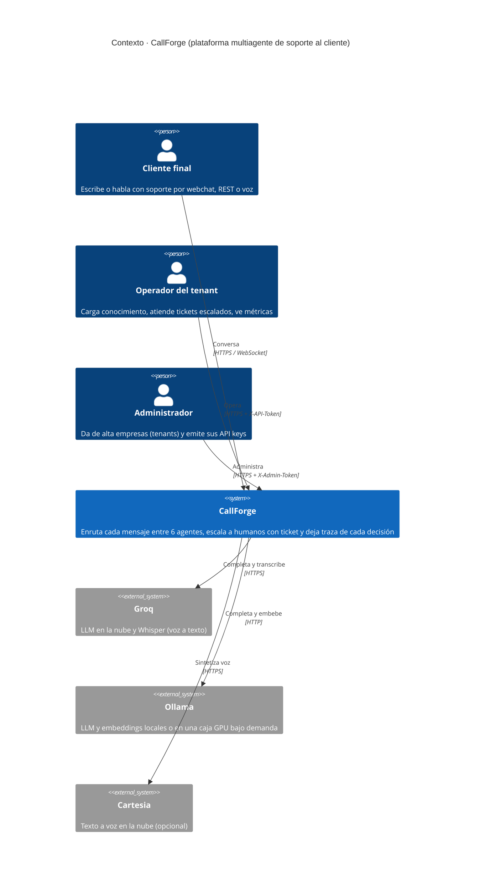
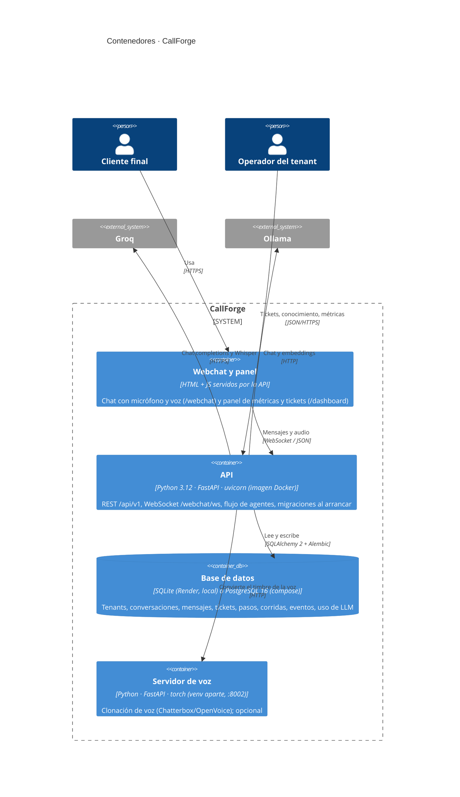
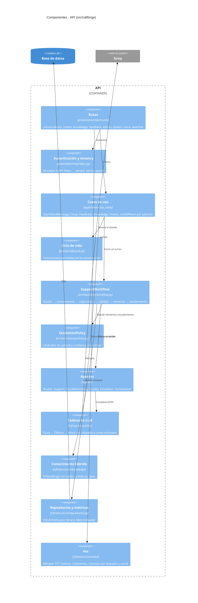
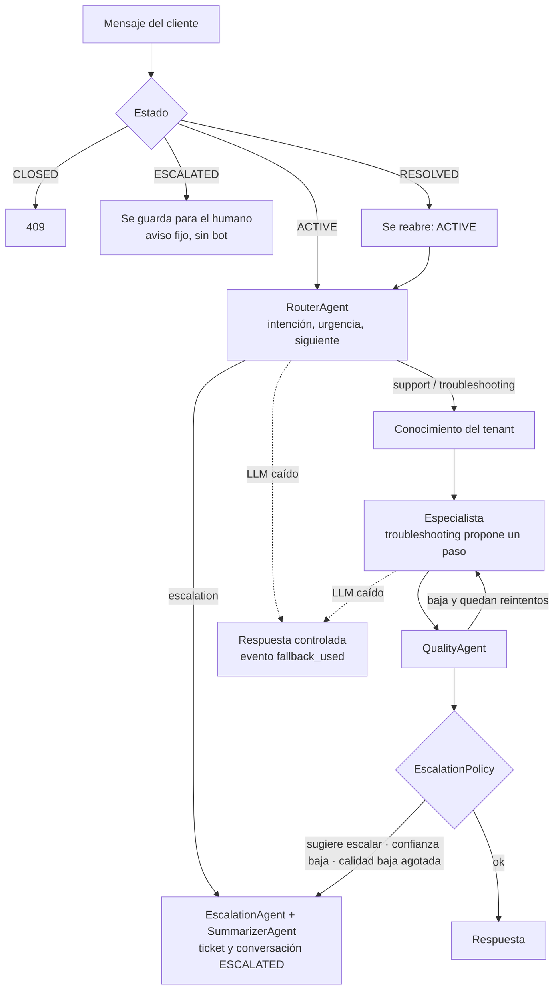
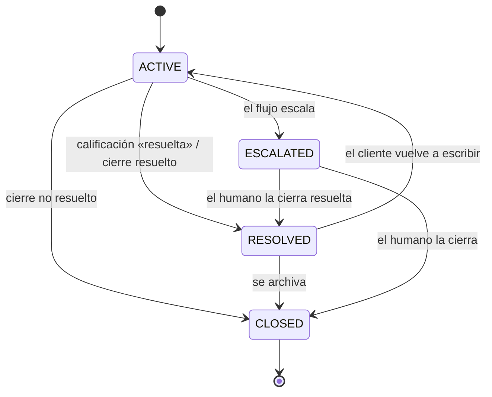

# Arquitectura · Switchboard (CallForge)

Modelo C4: contexto → contenedores → componentes. Los diagramas son texto (Mermaid) y se versionan con el
código; cada caja corresponde a un módulo real del repositorio. Decisiones en [`docs/adr/`](../adr/), reglas y
sus pruebas en [`docs/reglas.md`](../reglas.md), contrato de la API en [`docs/api/openapi.json`](../api/openapi.json).

## 1. Contexto

Sin ninguna llave ni Ollama, CallForge contesta con el `MockProvider` determinista: así corre el CI y así
arranca la demo en Render (`MOCK_ENABLED=true`).

## 2. Contenedores

## 3. Componentes de la API

## 4. Un turno de soporte

Cada agente deja una corrida (`agent_runs`: entrada, salida, decisión, confianza, latencia, modelo, proveedor,
tokens, costo, error) y el flujo sus eventos (`agent_events`): esa traza alimenta `/metrics` y el lote golden.

## 5. Ciclo de vida de la conversación

## 6. Despliegue

| Pieza | Dónde | Cómo |
|---|---|---|
| API (imagen `Dockerfile`) | Render, servicio web `callforge` (plan free) | Blueprint `render.yaml`, `autoDeploy` desde `main`, `healthCheckPath: /api/v1/health` |
| Base de datos | SQLite dentro del contenedor (`/app/data`) | Sin disco persistente en el plan free: se pierde en cada despliegue (ver RUNBOOK) |
| Servidor de voz | Equipo con GPU, fuera de Render | Manual (`voice_server.py`, venv con torch) |
| Servicio local | Windows con nssm | `scripts/install-windows-service.ps1` (manual) |

Detalle, variables, verificación y reversa en [`RUNBOOK.md`](../../RUNBOOK.md).
